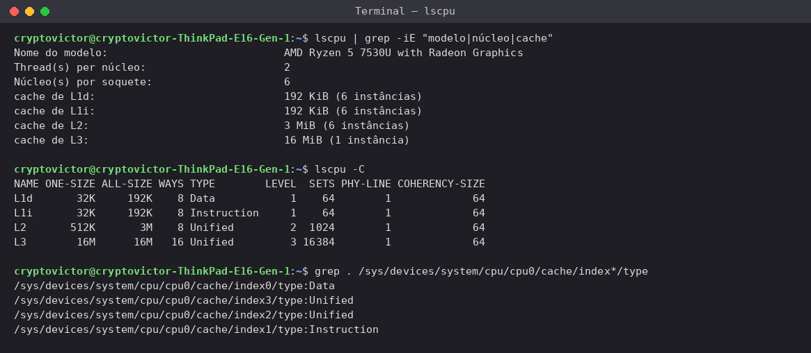
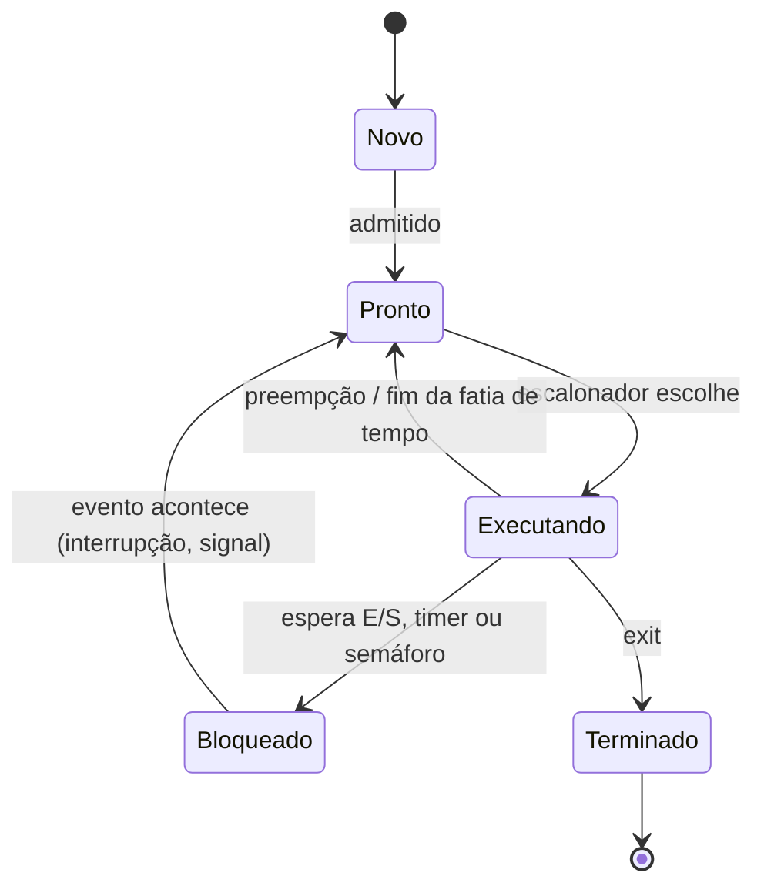
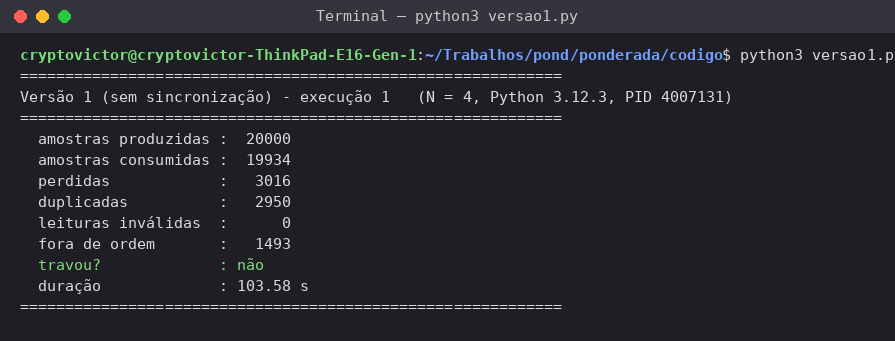
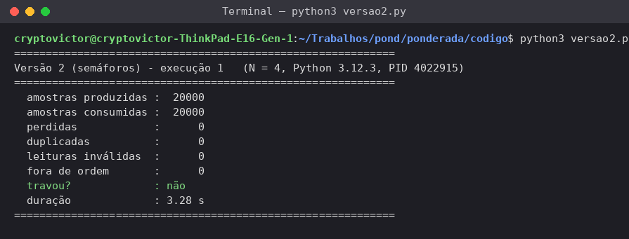
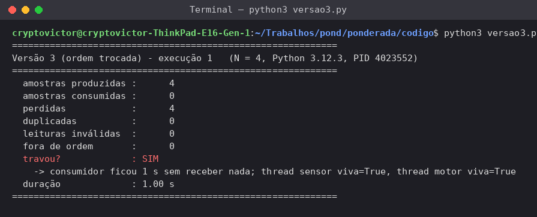
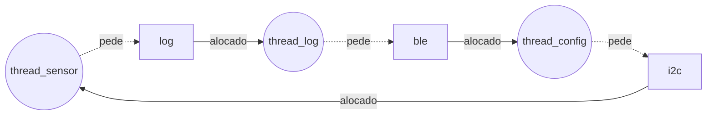

**Victor Garcia dos Santos** · D1 = 6 · D2 = 1 · N = 4

# Ponderada CC08: do pipeline ao deadlock (pulseira Tato)

## Parâmetros individuais

Nome contado só por letras: Victor (6) + Garcia (6) + dos (3) + Santos (6) = **21 letras**.

| Parâmetro | Fórmula | Conta | Valor |
|---|---|---|---|
| D1 | letras do primeiro nome | "Victor" = 6 | **6** |
| D2 | último dígito do total | 21 → 1 | **1** |
| IC (instruções por amostra) | 100.000 + 20.000 × D2 | 100.000 + 20.000 × 1 | **120.000** |
| m (falta na L1 do SoC) | 3% + 0,5% × D1 | 3% + 0,5% × 6 = 3% + 3% | **6% = 0,06** |
| N (buffer da A4) | 3 + (D2 mod 5) | 3 + (1 mod 5) = 3 + 1 | **4** |

Requisito: cada amostra processada em **≤ 5 ms** (período de amostragem de 10 ms).

---

# Parte A: o problema técnico

## A1. Arquitetura e memória: qual processador vai na pulseira?

### A1.1 Plataforma H (microcontrolador Harvard, 48 MHz, CPI 1,5)

```
ciclos   = IC × CPI = 120.000 × 1,5 = 180.000 ciclos
período  = 1 / 48 MHz = 20,83 ns
tempo    = ciclos / f = 180.000 / 48.000.000 = 0,00375 s = 3,75 ms
```

**3,75 ms ≤ 5 ms: atende**, com folga de 1,25 ms (usa 75% do orçamento). Como não há sistema operacional nem cache, esse tempo é **determinístico**: o pior caso é igual ao caso médio.

### A1.2 Plataforma V (SoC Von Neumann, 1,2 GHz, cache L1)

Tempo médio de acesso à memória:

```
AMAT = tempo de acerto + m × penalidade
     = 1 + 0,06 × 120
     = 1 + 7,2 = 8,2 ciclos
```

CPI efetivo (fórmula do enunciado):

```
CPI_ef = 1,0 + (acessos por instrução × m × penalidade)
       = 1,0 + (1,3 × 0,06 × 120)
       = 1,0 + 9,36 = 10,36
```

Tempo por amostra e pior caso:

```
ciclos      = IC × CPI_ef = 120.000 × 10,36 = 1.243.200 ciclos
tempo médio = 1.243.200 / 1.200.000.000 = 0,001036 s = 1,036 ms
pior caso   = 1,036 ms + 3 ms (atraso do Linux) = 4,036 ms
```

**4,036 ms ≤ 5 ms: atende, mas por pouco.** A folga cai para 0,96 ms (usa 81% do orçamento). Dois avisos:

- O CPI ideal da V seria 1,0, mas as faltas na cache multiplicam esse CPI por **10,4**. Com 6% de falta, **90% dos ciclos** da V são o processador parado esperando a DRAM (9,36 de 10,36).
- Os 3 ms do Linux são um limite "até", não uma garantia. Um Linux comum não é sistema de tempo real, então um pico maior que 3,96 ms já estoura o requisito.

### A1.3 Acelerador DSP na Plataforma H (Lei de Amdahl)

Fração acelerada f = 0,60 (filtro), ganho da parte acelerada s = 5.

```
Speedup = 1 / ((1 − f) + f / s)
        = 1 / (0,40 + 0,60 / 5)
        = 1 / (0,40 + 0,12)
        = 1 / 0,52 ≈ 1,92×

novo tempo = 3,75 ms / 1,923 = 3,75 × 0,52 = 1,95 ms
```

**1,95 ms: atende com folga grande** (39% do orçamento). Note que um acelerador 5× rápido só deixa o sistema 1,92× mais rápido, porque os 40% que não são filtro continuam iguais. Mesmo com DSP infinitamente rápido, o limite seria 1 / 0,40 = 2,5×.

Para a minha IC, a H já atendia sem o DSP (3,75 ms). O DSP serve para **margem**: sem ele, se o firmware crescer 33% (IC de 160.000), o tempo chega a 5 ms. Com ele, cabe até IC ≈ 120.000 × 5 / 1,95 ≈ **307 mil instruções**.

| Plataforma | Tempo médio | Pior caso | Atende 5 ms? | Uso do orçamento (pior caso) |
|---|---|---|---|---|
| H | 3,75 ms | 3,75 ms | Sim | 75% |
| H + DSP | 1,95 ms | 1,95 ms | Sim | 39% |
| V | 1,036 ms | 4,036 ms | Sim, por pouco | 81% |

### A1.4 Por que a V precisa de cache e a H não?

Na V, instruções e dados passam pelo **mesmo barramento** até uma DRAM externa que custa 120 ciclos. Isso é o gargalo de Von Neumann: o processador de 1,2 GHz é muito mais rápido que a memória. Sem cache, o CPI seria 1 + 1,3 × 120 = **157**, e cada amostra levaria 120.000 × 157 / 1,2 GHz = **15,7 ms**, três vezes acima do limite. A cache é o que esconde essa lentidão. Já a H é Harvard, com barramentos separados para instrução e dados, e sua SRAM interna responde em 1 ciclo a 48 MHz. Lá a memória acompanha o processador, então não existe gargalo para esconder.

### A1.5 Evidência da minha máquina



Meu processador é um AMD Ryzen 5 7530U. **A L1 é dividida**: L1i (instruções) de 32 KiB e L1d (dados) de 32 KiB por núcleo, 6 núcleos. A L2 (512 KiB por núcleo) e a L3 (16 MiB) são **unificadas** (`Unified`).

Então meu computador é **Von Neumann, numa arquitetura chamada "Harvard modificada"**. Só o nível mais próximo do núcleo (a L1) é separado como na Harvard, para buscar instrução e dado no mesmo ciclo. Da L2 para baixo, e principalmente na RAM, instruções e dados ficam na **mesma memória e no mesmo espaço de endereçamento**. É por isso que um programa pode ser carregado como dado e depois executado. Esse é o modelo Von Neumann que o programador e o sistema operacional enxergam.

---

## A2. Pipeline: o loop do filtro

```asm
1  lw   x5, 0(x10)     # lê a amostra nova
2  add  x6, x6, x5     # soma += nova
3  lw   x7, 0(x11)     # lê a amostra mais antiga
4  sub  x6, x6, x7     # soma -= antiga
5  sw   x6, 0(x12)     # grava a soma
6  addi x10, x10, 4    # avança o ponteiro da nova
7  addi x11, x11, 4    # avança o ponteiro da antiga
```

### A2.1 Dependências RAW (leitura depois de escrita)

| Consumidora | Depende de | Registrador | Distância | Tipo |
|---|---|---|---|---|
| 2 `add` | 1 `lw` | x5 | 1 | **load-use** |
| 4 `sub` | 3 `lw` | x7 | 1 | **load-use** |
| 4 `sub` | 2 `add` | x6 | 2 | ALU → ALU |
| 5 `sw` | 4 `sub` | x6 | 1 | ALU → store (dado a gravar) |

Não são RAW: 6 → 1 (x10) e 7 → 3 (x11) são **WAR** (escrita depois de leitura). Num pipeline em ordem elas não causam bolha, mas impedem que os `addi` subam para antes dos `lw` que leem o ponteiro antigo. O `add` também lê x6 da iteração anterior, mas essa dependência está fora do trecho.

### A2.2 Sem forwarding

Regra: o banco de registradores escreve na 1ª metade do ciclo e lê na 2ª. Então a consumidora pode fazer ID **no mesmo ciclo** do WB da produtora. Se as duas estão coladas, são **2 bolhas**. `st` indica ciclo parado (bolha).

| Instr. | 1 | 2 | 3 | 4 | 5 | 6 | 7 | 8 | 9 | 10 | 11 | 12 | 13 | 14 | 15 | 16 | 17 |
|---|---|---|---|---|---|---|---|---|---|---|---|---|---|---|---|---|---|
| 1 lw x5 | IF | ID | EX | MEM | **WB** | | | | | | | | | | | | |
| 2 add x6 | | IF | st | st | **ID** | EX | MEM | **WB** | | | | | | | | | |
| 3 lw x7 | | | IF | st | st | ID | EX | MEM | **WB** | | | | | | | | |
| 4 sub x6 | | | | | | IF | st | st | **ID** | EX | MEM | **WB** | | | | | |
| 5 sw x6 | | | | | | | IF | st | st | st | st | **ID** | EX | MEM | WB | | |
| 6 addi x10 | | | | | | | | | | IF | st | st | ID | EX | MEM | WB | |
| 7 addi x11 | | | | | | | | | | | | | IF | ID | EX | MEM | WB |

- 2 espera o WB de 1 (ciclo 5): 2 bolhas.
- 4 espera o WB de 3 (ciclo 9). O WB de 2 (ciclo 8) já passou: 2 bolhas.
- 5 espera o WB de 4 (ciclo 12): 2 bolhas.

**Total: 17 ciclos** do primeiro IF ao último WB = 11 ciclos ideais (5 + 7 − 1) + **6 bolhas**.

### A2.3 Com forwarding

Caminhos EX/MEM → EX e MEM/WB → EX. Uma dependência ALU → ALU não para mais. Uma **load-use** ainda custa **1 bolha**.

| Instr. | 1 | 2 | 3 | 4 | 5 | 6 | 7 | 8 | 9 | 10 | 11 | 12 | 13 |
|---|---|---|---|---|---|---|---|---|---|---|---|---|---|
| 1 lw x5 | IF | ID | EX | **MEM** | WB | | | | | | | | |
| 2 add x6 | | IF | ID | st | **EX** | MEM | WB | | | | | | |
| 3 lw x7 | | | IF | st | ID | EX | **MEM** | WB | | | | | |
| 4 sub x6 | | | | | IF | ID | st | **EX** | MEM | WB | | | |
| 5 sw x6 | | | | | | IF | st | ID | **EX** | MEM | WB | | |
| 6 addi x10 | | | | | | | | IF | ID | EX | MEM | WB | |
| 7 addi x11 | | | | | | | | | IF | ID | EX | MEM | WB |

Encaminhamentos usados: 1 → 2 (x5, MEM/WB → EX no ciclo 5), 3 → 4 (x7, MEM/WB → EX no ciclo 8) e 4 → 5 (x6, EX/MEM → EX no ciclo 9). A dependência 2 → 4 (x6) já está resolvida pelo banco de registradores.

**Total: 13 ciclos** = 11 + **2 bolhas**.

**O que continua causando bolha: as duas dependências load-use (1 → 2 por x5 e 3 → 4 por x7).** O `lw` só tem o dado no **fim do estágio MEM**, porque é ali que a memória é lida. A instrução seguinte precisa dele no **começo do EX**, que é o mesmo ciclo do MEM do `lw`. O forwarding não consegue mandar um valor para trás no tempo, então a consumidora espera 1 ciclo e pega o dado pelo caminho MEM/WB → EX.

### A2.4 Reordenação sem bolhas

A ideia é afastar cada `lw` do seu consumidor, colocando instruções independentes no meio. Os `addi` só podem vir **depois** do `lw` que usa o mesmo ponteiro, por causa da WAR.

```asm
1  lw   x5, 0(x10)     # lê a amostra nova
2  lw   x7, 0(x11)     # lê a amostra mais antiga (subiu)
3  addi x10, x10, 4    # independente; lw x5 já leu x10
4  add  x6, x6, x5     # x5 está pronto há 3 instruções
5  sub  x6, x6, x7     # x7 está pronto há 3 instruções; x6 vem por EX/MEM
6  sw   x6, 0(x12)     # x6 vem por EX/MEM
7  addi x11, x11, 4    # lw x7 já leu x11
```

O resultado não muda: a soma é a mesma (soma + nova − antiga), o mesmo valor vai para 0(x12), e x10 e x11 terminam com +4.

| Instr. | 1 | 2 | 3 | 4 | 5 | 6 | 7 | 8 | 9 | 10 | 11 |
|---|---|---|---|---|---|---|---|---|---|---|---|
| lw x5 | IF | ID | EX | MEM | WB | | | | | | |
| lw x7 | | IF | ID | EX | MEM | WB | | | | | |
| addi x10 | | | IF | ID | EX | MEM | WB | | | | |
| add x6 | | | | IF | ID | EX | MEM | WB | | | |
| sub x6 | | | | | IF | ID | EX | MEM | WB | | |
| sw x6 | | | | | | IF | ID | EX | MEM | WB | |
| addi x11 | | | | | | | IF | ID | EX | MEM | WB |

**Novo total: 11 ciclos, 0 bolhas** (o mínimo para 7 instruções num pipeline de 5 estágios). Comparado aos 17 ciclos sem forwarding, são 35% menos ciclos.

---

## A3. Processos e threads: como organizar o software

### A3.1 Organização proposta

| Unidade | Tarefas | Por quê |
|---|---|---|
| **Processo 1: tempo real** (prioridade alta, `SCHED_FIFO`) | Thread **sensor**, thread **processamento**, thread **motor** | As três formam o caminho crítico de 5 ms e compartilham o buffer de amostras. Como threads, dividem a mesma memória: a amostra passa de uma para outra sem cópia e sem chamada ao kernel. Criar uma thread e trocar de contexto entre threads do mesmo processo é barato, porque não muda o espaço de endereçamento (não precisa trocar tabela de páginas nem invalidar a TLB). |
| **Processo 2: comunicação** (prioridade baixa, usuário sem privilégio) | **BLE** (envia log e recebe comandos) | O BLE não é crítico no tempo: um log atrasado não machuca ninguém. E ele conversa com o mundo de fora. Isolado num processo, uma falha nele (crash, laço infinito, invasão) não derruba a vibração. Ele recebe o log e manda comandos por IPC (fila ou socket) com formato fixo e validado. |

O custo de pôr o BLE em outro processo é uma cópia por IPC e uma troca de contexto mais cara. Isso acontece algumas vezes por segundo, fora do caminho de 5 ms, então é aceitável. O custo de pôr sensor, processamento e motor em processos separados seria pagar IPC **100 vezes por segundo** dentro do caminho crítico. Isso não compensa, e os três falham juntos de qualquer forma: sem sensor, o motor não tem o que fazer.

Um **supervisor** (o `systemd`, ou um watchdog) reinicia o processo 2 se ele morrer, sem tocar no processo 1.

### A3.2 BLE como thread ou como processo, se alguém explorar uma falha nele

- **Thread no processo principal:** o atacante herda **o espaço de endereçamento inteiro**. Ele pode ler e alterar o buffer de amostras, zerar a intensidade da vibração, mudar a calibração do sensor ou simplesmente travar o processo. Também ganha os privilégios do processo de tempo real. Para quem usa, a pulseira pode "dizer" que o caminho está livre quando não está. E se a thread BLE só der crash, ela derruba junto as threads de sensor e motor.
- **Processo separado:** a MMU impede que ele leia ou escreva a memória do processo 1. O único caminho é o canal de IPC, que só aceita mensagens de formato fixo e valida limites (por exemplo, intensidade entre 0 e 100). Dá para rodar com usuário sem privilégio e com `seccomp`, e o crash fica contido: o supervisor reinicia o BLE e a vibração continua. O estrago máximo é perder o log e a configuração remota, não o aviso de obstáculo.

### A3.3 Diagrama de estados de um processo



Versão em texto, caso o Mermaid não renderize:

```
 Novo ──admitido──► Pronto ◄──── preempção ───── Executando ──exit──► Terminado
                      ▲  └──── escalonador ────────►  │
                      │                               │ espera E/S / timer / semáforo
                      └──── evento ocorre ── Bloqueado ◄┘
```

**A thread do sensor passa quase todo o tempo em Bloqueado.** Ela acorda a cada 10 ms (timer ou interrupção do sensor), faz uma leitura curta pelo I2C, coloca a amostra no buffer e volta a dormir esperando a próxima. Mesmo que a leitura levasse 0,5 ms, ela estaria executando só 0,5 / 10 = 5% do tempo e bloqueada nos outros **95%**. Na prática a leitura leva dezenas de microssegundos, então fica bloqueada mais de 99% do tempo. Isso é bom: uma thread presa em E/S não gasta CPU, e quando o evento chega ela vai para Pronto e, por ter a prioridade mais alta, é escolhida na hora.

---

## A4. Código com semáforos: o buffer entre o sensor e o motor

Código em [`codigo/`](codigo/), em Python 3 com `threading`, buffer circular de **N = 4** posições, 20.000 amostras por execução. Cada versão roda com um comando (`python3 versao1.py`, `versao2.py`, `versao3.py`). O script `rodar_tudo.sh` faz as 9 execuções e salva os logs em [`codigo/logs/`](codigo/logs/).

Como cada coluna foi medida:
- **consumidas:** leituras feitas pelo consumidor, contando repetições.
- **perdidas:** amostras que o produtor colocou no buffer e o consumidor nunca recebeu.
- **duplicadas:** leituras a mais de uma amostra que já tinha sido recebida.
- **travou:** o consumidor ficou 1 s sem receber nada (detectado por um watchdog na thread principal).

| Versão | Execução | Produzidas | Consumidas | Perdidas | Duplicadas | Travou? | Duração |
|---|---|---|---|---|---|---|---|
| 1, sem sincronização | 1 | 20.000 | 19.934 | 3.016 | 2.950 | não | 103,6 s |
| 1, sem sincronização | 2 | 20.000 | 20.008 | 3.137 | 3.145 | não | 103,9 s |
| 1, sem sincronização | 3 | 20.000 | 19.928 | 3.008 | 2.936 | não | 103,7 s |
| 2, semáforos | 1 | 20.000 | 20.000 | 0 | 0 | não | 3,3 s |
| 2, semáforos | 2 | 20.000 | 20.000 | 0 | 0 | não | 3,2 s |
| 2, semáforos | 3 | 20.000 | 20.000 | 0 | 0 | não | 3,2 s |
| 3, ordem trocada | 1 | 4 | 0 | 4 | 0 | **sim** | 1,0 s |
| 3, ordem trocada | 2 | 4 | 0 | 4 | 0 | **sim** | 1,0 s |
| 3, ordem trocada | 3 | 4 | 0 | 4 | 0 | **sim** | 1,0 s |

Na versão 1, cerca de **15% das amostras se perderam** e outros ~15% das leituras foram repetidas. Além disso, entre 1.493 e 1.579 leituras chegaram **fora de ordem**, ou seja, o motor vibrou por uma amostra mais antiga que a anterior. Repare que o total consumido fica perto de 20.000. Isso não é sinal de acerto: os dois erros se compensam (consumidas − produzidas = duplicadas − perdidas). Na versão 3, as 4 amostras "perdidas" são as N = 4 que ficaram presas no buffer cheio na hora do deadlock.

A espera ocupada também tem custo: a versão 1 levou **~104 s**, contra **~3,2 s** da versão 2, para o mesmo trabalho. A thread que gira esperando não faz nada útil e segura a CPU (e, em Python, o GIL) até o escalonador tirá-la. Na pulseira, isso seria bateria gasta à toa e latência para as outras threads.

### Prints

**Versão 1:** sem sincronização, perde e duplica amostras.



**Versão 2:** com semáforos, as 20.000 amostras chegam certas.



**Versão 3:** ordem trocada, deadlock depois de 4 amostras.



A saída completa das 9 execuções está em [`codigo/logs/`](codigo/logs/).

### Região crítica da versão 1, e por que ela perde e duplica amostras

A **região crítica** é a atualização do contador compartilhado `ocupadas`, junto com a escrita e a leitura do buffer que dependem dele:

```python
# produtor                          # consumidor
valor = buf.ocupadas                valor = buf.ocupadas
time.sleep(0)   # interrompida      time.sleep(0)   # interrompida
buf.ocupadas = valor + 1            buf.ocupadas = valor - 1
```

`ocupadas += 1` parece uma operação só, mas são três passos: **ler, calcular e escrever**. Se a outra thread roda entre a leitura e a escrita, uma das atualizações **some** (*lost update*). Exemplo com 2 amostras no buffer:

| Passo | Produtor | Consumidor | `ocupadas` |
|---|---|---|---|
| 1 | lê 2 | | 2 |
| 2 | `sleep(0)` cede a CPU | lê 2 | 2 |
| 3 | | escreve 2 − 1 = 1 | 1 |
| 4 | escreve 2 + 1 = **3** | | **3** (o real é 2) |

A partir daí o contador mente, e os dois erros aparecem:

- **Duplica:** quando se perde um *decremento*, o contador fica **maior** que o real. O consumidor acha que há uma amostra nova, lê uma posição que já tinha lido e manda o motor vibrar de novo por uma amostra velha.
- **Perde:** quando se perde um *incremento*, o contador fica **menor** que o real. O produtor acha que há vaga e **sobrescreve** uma amostra que o consumidor ainda não leu. Essa amostra nunca chega ao motor.

Para a pulseira, uma amostra perdida pode ser o poste que apareceu. Uma amostra duplicada ou fora de ordem faz o motor descrever um obstáculo que já mudou de lugar.

### O que cada semáforo garante na versão 2

| Semáforo | Valor inicial | Quem espera (`wait`) | Quem sinaliza (`signal`) | Garante |
|---|---|---|---|---|
| `vazio` | N = 4 | produtor, antes de escrever | consumidor, depois de ler | O produtor **nunca sobrescreve** uma amostra não lida: com 4 posições ocupadas, ele dorme. Isso acaba com as perdas. |
| `cheio` | 0 | consumidor, antes de ler | produtor, depois de escrever | O consumidor **nunca lê posição vazia ou já lida**: sem amostra nova, ele dorme (sem gastar CPU, ao contrário da espera ocupada). Isso acaba com as duplicadas. |
| `mutex` | 1 | os dois, ao entrar na região crítica | os dois, ao sair | **Exclusão mútua:** só uma thread mexe em `dados`, `entrada` e `saida` por vez. Mesmo com o `sleep(0)` dentro da região crítica, a outra thread não entra no meio. |

`vazio` e `cheio` substituem o contador `ocupadas` da versão 1. A soma deles é sempre N, e quem atualiza essas contagens é o próprio semáforo, de forma **atômica**. Por isso não existe mais o "ler, ser interrompido, escrever" que causava a corrida.

### O que aconteceu na versão 3, e por quê

**As três execuções travaram do mesmo jeito: 4 amostras produzidas, 0 consumidas, deadlock em 1 s.** As duas threads continuavam vivas, só que presas para sempre.

O que aconteceu, passo a passo:

1. O produtor sai na frente e enche o buffer: 4 vezes `wait(mutex)`, `wait(vazio)`, escreve, `signal(mutex)`, `signal(cheio)`. Agora `vazio = 0` e `cheio = 4`.
2. Na 5ª amostra, o produtor faz `wait(mutex)` e consegue. Depois faz `wait(vazio)` e **dorme segurando o mutex**, porque não há vaga.
3. O consumidor faz `wait(cheio)` e consegue (há 4 itens). Depois faz `wait(mutex)` e **dorme**, porque o mutex está com o produtor.
4. Só o consumidor pode dar `signal(vazio)`, mas ele espera o mutex. Só o produtor pode dar `signal(mutex)`, mas ele espera `vazio`. **Espera circular: deadlock.**

As quatro condições aparecem: exclusão mútua (o mutex), posse e espera (o produtor segura o mutex enquanto espera `vazio`), não preempção (`acquire` sem timeout) e espera circular (produtor → consumidor → produtor).

A regra que a versão 2 segue e a 3 quebra é: **espere primeiro pelo recurso que pode demorar (vaga ou item) e só pegue o mutex quando for de fato usar o buffer.** Nunca durma segurando o mutex. Travou já na 5ª amostra porque o produtor é mais rápido, e o buffer de N = 4 enche antes de o consumidor ter a vez. Na pulseira, isso seria o motor parado 50 ms depois de ligar, para sempre, até alguém desligar e ligar.

---

## A5. Deadlock: a pulseira congelou

```
thread_sensor:         thread_log:            thread_config:
  P(i2c)                 P(log)                 P(ble)
  le_sensor()            le_log()               recebe_comando()
  P(log)                 P(ble)                 P(i2c)
  registra()             envia()                ajusta_sensor()
  V(log)                 V(ble)                 V(i2c)
  V(i2c)                 V(log)                 V(ble)
```

### A5.1 Sequência que leva ao deadlock e grafo de alocação

| Passo | Thread | Ação | i2c | log | ble |
|---|---|---|---|---|---|
| t1 | sensor | `P(i2c)` consegue e chama `le_sensor()` | sensor | livre | livre |
| t2 | log | `P(log)` consegue e chama `le_log()` | sensor | log | livre |
| t3 | config | `P(ble)` consegue e chama `recebe_comando()` | sensor | log | config |
| t4 | sensor | `P(log)` **bloqueia**: log é da thread_log | sensor | log | config |
| t5 | log | `P(ble)` **bloqueia**: ble é da thread_config | sensor | log | config |
| t6 | config | `P(i2c)` **bloqueia**: i2c é da thread_sensor | sensor | log | config |

Depois de t6, as três threads estão bloqueadas, e cada uma espera um `V()` que só outra bloqueada poderia fazer. Ninguém acorda. É exatamente o "congelou e só voltou desligando e ligando".

Grafo de alocação de recursos depois de t6. Seta recurso → thread significa **alocado a**; seta thread → recurso significa **pedindo**.



```
         alocado              pede
  [i2c] ────────► (sensor) - - - - ► [log]
    ▲                                  │ alocado
    ┆ pede                             ▼
 (config) ◄──────── [ble] ◄- - - - (log_t)
           alocado          pede
```

O grafo tem um **ciclo**: sensor → log → thread_log → ble → thread_config → i2c → sensor. Como cada recurso tem uma única instância, um ciclo no grafo é **deadlock garantido**.

### A5.2 As quatro condições necessárias (Coffman) no código

| Condição | Onde aparece |
|---|---|
| **Exclusão mútua** | Os três semáforos são binários (começam em 1): o barramento I2C, o arquivo de log e o rádio BLE só têm um dono por vez. No I2C isso é físico: duas transações misturadas corrompem a leitura. |
| **Posse e espera** | Cada thread pede o segundo recurso **sem soltar o primeiro**: a thread_sensor faz `P(log)` segurando i2c, a thread_log faz `P(ble)` segurando log, e a thread_config faz `P(i2c)` segurando ble. |
| **Não preempção** | `P()` espera para sempre e só o dono faz `V()`. Ninguém consegue tomar o i2c da thread_sensor à força, nem existe timeout. |
| **Espera circular** | Cada thread pede os recursos numa ordem diferente (i2c→log, log→ble, ble→i2c). Juntas, essas ordens fecham o ciclo sensor → thread_log → thread_config → sensor. |

### A5.3 Duas correções de tipos diferentes

**Correção 1: prevenção, quebrando a posse e espera ("nunca segure dois").** Cada thread copia o que precisa para uma variável local, solta o recurso e só depois pede o próximo:

```
thread_sensor:              thread_log:               thread_config:
  P(i2c)                      P(log)                    P(ble)
  d = le_sensor()             l = le_log()              c = recebe_comando()
  V(i2c)                      V(log)                    V(ble)
  P(log)                      P(ble)                    P(i2c)
  registra(d)                 envia(l)                  ajusta_sensor(c)
  V(log)                      V(ble)                    V(i2c)
```

Nenhuma thread segura dois semáforos ao mesmo tempo, então não existe arco "segura um e pede outro" e o ciclo é impossível. Uma alternativa seria impor uma **ordem global** (i2c < log < ble). Só que aí a thread_config precisaria pegar o i2c **antes** de esperar um comando BLE, e o sensor ficaria parado enquanto o celular não manda nada. Isso estoura os 5 ms, então descartei.
*Para quem usa:* **nada muda de visível**, e fica até melhor. A pulseira simplesmente não congela mais por esse motivo. A thread_sensor segura o I2C por menos tempo, o que reduz a latência. O custo é do time: reescrever e testar as três threads (os ~2 meses do Dilema 1).

**Correção 2: detecção e recuperação (watchdog).** Cada thread "dá sinal de vida" a cada ciclo, e o motor confirma a vibração de cada amostra. Um watchdog de hardware (um timer independente da CPU) é alimentado só se todas as threads deram sinal nos últimos ~50 ms (5 amostras). Se o deadlock acontecer, o sinal para, o watchdog estoura e **reinicia a pulseira** (ou só o processo de tempo real).
*Para quem usa:* o congelamento deixa de ser permanente, mas a pessoa **fica cerca de 4 s sem vibração** enquanto a pulseira reinicia, avisada por um pulso longo. É um remendo: o deadlock continua acontecendo, só que agora se cura sozinho. A vantagem é que fica pronto em dias, não em meses, e protege também contra travamentos que ainda não conhecemos.

O ideal é usar as duas: a prevenção elimina **esse** deadlock, e o watchdog continua como cinto de segurança para os outros.

---

# Parte B: a decisão do CTO

## Memorando ao conselho da Tato: qual processador vai para a produção (Dilema 2)

**Para:** Conselho da Tato · **De:** Victor Garcia dos Santos, CTO · **Assunto:** escolha da plataforma de produção

**Decisão: a primeira versão da Tato vai para produção na Plataforma H (microcontrolador Harvard) com o acelerador DSP, a R$ 37 por unidade.**

**Por quê.** O requisito que não se negocia é processar cada amostra em até 5 ms, *sempre*. Pelas minhas contas (A1), a H com DSP processa uma amostra em **1,95 ms**, toda vez, porque não tem sistema operacional nem cache para variar o tempo. Isso usa 39% do orçamento. A Plataforma V é mais rápida na média (1,036 ms), mas o pior caso é **4,036 ms** (81% do orçamento). Essa conta depende de o Linux nunca atrasar mais de 3 ms, e um Linux comum não dá essa garantia. Um atraso de 4 ms em vez de 3 e a pessoa passa pelo poste sem aviso. Entre ser mais rápida na média e ser previsível no pior caso, uma pulseira de segurança precisa da segunda opção. Coloquei o DSP mesmo com a H atendendo sem ele (3,75 ms) porque sem ele um aumento de 33% no firmware já estoura o limite. Com ele, o código pode crescer até ~2,5 vezes.

**Do que estamos abrindo mão.** De duas coisas:
1. **Atualização pela internet (OTA).** Toda correção de firmware, como a do deadlock da A5, vai exigir que o usuário leve ou mande a pulseira para a assistência técnica. Quem paga é **o usuário**, que fica sem a pulseira durante o reparo, e **a empresa**, que paga a logística de cada campanha de atualização.
2. **O ecossistema do Linux**, ou seja, bibliotecas prontas e desenvolvimento mais rápido. Quem paga é **o time**, que escreve firmware em C sem sistema operacional e vai mais devagar nas próximas funcionalidades.

Em troca, economizamos **R$ 33 por unidade** (R$ 37 contra R$ 70), ou **R$ 66 mil** nas primeiras 2.000 pulseiras.

**Impacto em quem usa e risco de segurança.** Para o usuário, a vibração chega sempre no mesmo tempo e a bateria dura mais (48 MHz e sem DRAM gastam muito menos que 1,2 GHz rodando Linux). Na segurança, a superfície de ataque é pequena: não há Linux, rede IP nem serviços rodando, só o BLE. O risco que fica é o inverso: **se aparecer uma falha no BLE, não dá para corrigir remotamente.** Para conter isso, o BLE da H só envia log e aceita uma lista fechada de comandos com valores limitados, e o firmware só aceita atualização assinada, mesmo por cabo.

**O que me faria mudar de ideia.** Mudo para a Plataforma V se **qualquer uma** destas condições acontecer:
- Um teste com 1 milhão de amostras na V com kernel de tempo real (PREEMPT_RT) mostra pior caso abaixo de **2,5 ms**, ou seja, metade do orçamento.
- Na primeira campanha de correção por cabo, o custo logístico passa de **R$ 33 por pulseira**, que é a economia que estamos fazendo.
